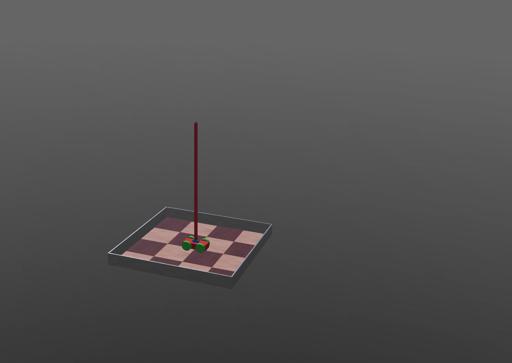
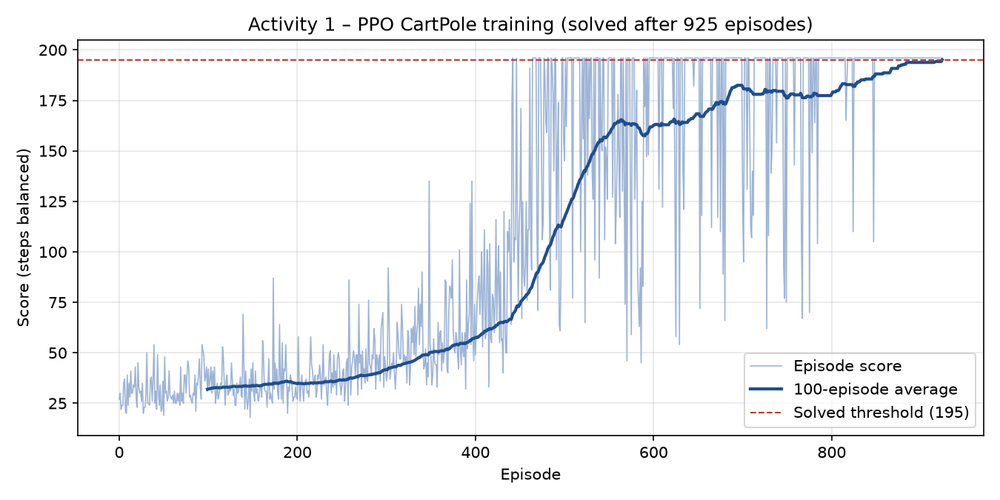
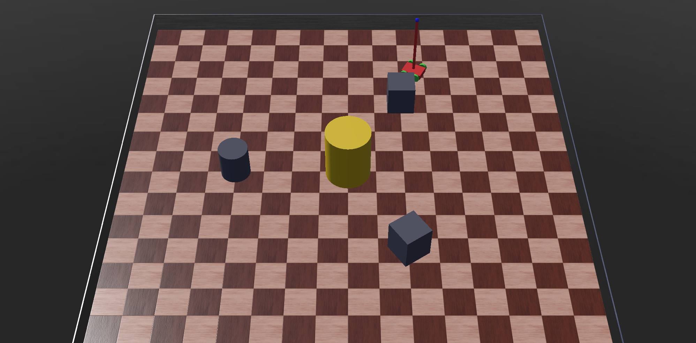
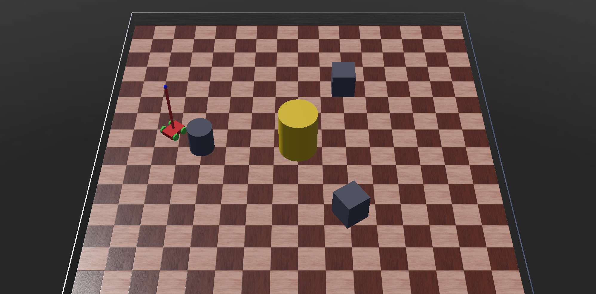
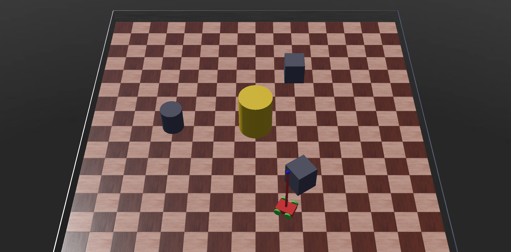
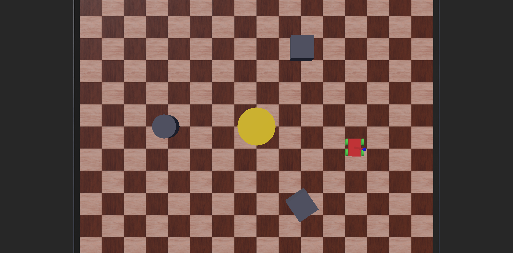
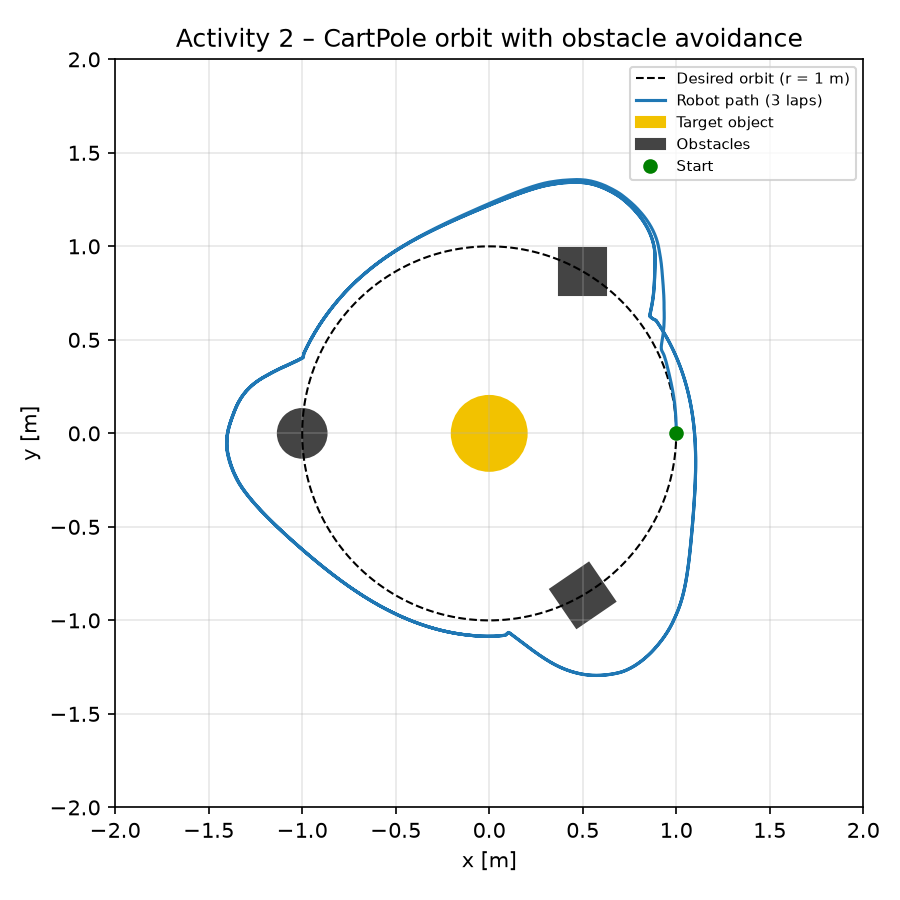

# Assignment 6 – CartPole with Webots R2025a + deepbots

| | Activity 1 | Activity 2 |
|---|---|---|
| Task | deepbots *Robot-Supervisor* CartPole tutorial, built natively | CartPole app generated from an AI prompt |
| Folder | `activity1_cartpole_robot_supervisor/` | `activity2_cartpole_obstacle_nav/` |
| World | `worlds/cartpole_world.wbt` | `worlds/cartpole_nav_world.wbt` |
| Controller | `controllers/robot_supervisor_controller/` | `controllers/cartpole_nav_controller/` |
| Result | PPO agent **solved** CartPole after 925 episodes | 3 laps around the target, **0 collisions**, closest obstacle centre 0.36 m |

**Software:** Webots R2025a, Python 3.12, deepbots 1.0.0, PyTorch 2.x, gym 0.26.2, NumPy.

---

## Environment setup (used by both activities)

```bash
cd assignment6
python3.12 -m venv .venv
source .venv/bin/activate
pip install --upgrade pip
pip install "deepbots==1.0.0" --no-deps
pip install torch numpy "gym==0.26.2"
```

> deepbots 1.0.0 pins `gym==0.21`, which no longer builds on modern setuptools, so deepbots is installed
> with `--no-deps` and `gym 0.26.2` is installed separately (the API deepbots uses is identical).

Each controller folder contains a `runtime.ini` that tells Webots which Python to use:

```ini
[python]
COMMAND = /Users/roneythomas/code/assignment6/.venv/bin/python
```

(Alternative: Webots → *Preferences → General → Python command*.)

---

# Activity 1 – CartPole Beginner Robot-Supervisor Scheme Tutorial (native)

In the Robot-Supervisor scheme a **single controller** runs on the robot *and* has supervisor
privileges, so the same Python class is both the robot controller and the gym-style RL environment
(`RobotSupervisorEnv`). The agent is a PPO actor-critic network written in PyTorch.

## Steps

1. **Create the project.** Webots → *File → New → New Project Directory…* → name it
   `activity1_cartpole_robot_supervisor`, world name `cartpole_world.wbt`, tick
   *Add a rectangle arena*.
2. **World settings.** Leave the default `RectangleArena` (1 m × 1 m). Save the world (Ctrl+S).
3. **Create the robot.** *Add node (+) → Base nodes → Robot*. Set `DEF ROBOT`, translation `0 0 0.04`,
   rotation `1 0 0 1.5708`.
4. **Robot body.** Add a `Shape` child (`DEF BODY`) with a `Box 0.2 × 0.05 × 0.08`, red
   `PBRAppearance`. Set `boundingObject USE BODY` and `physics Physics { mass 2, density -1 }`.
5. **Four wheels.** Add four `HingeJoint`s (`DEF WHEEL1…WHEEL4`), axis `0 0 1`, anchors
   `(±0.06, 0, ±0.05)`. Each has a `RotationalMotor` named `wheel1…wheel4` and an endpoint `Solid` with a
   green `Cylinder` (radius 0.04, height 0.02), bounding object and `Physics`.
6. **The pole.** Add a `HingeJoint` (`DEF POLE`) with anchor `0 0.03 0`, axis `0 0 1`,
   `minStop -1.3`, `maxStop 1.3`, and a `PositionSensor` named `polePosSensor`. Its endpoint `Solid` is a
   1 m red box (mass 0.2) with a small child sphere `DEF POLE_ENDPOINT` (mass 0.02) at the tip.
7. **Supervisor privileges.** Select the robot and set `supervisor TRUE`. Save the world.
8. **Create the controller.** *File → New → New Robot Controller…* → Python → name
   `robot_supervisor_controller`. Set the robot's `controller` field to it.
9. **Add helper files** to the controller folder: `PPO_agent.py` (PPO agent) and `utilities.py`
   (`normalize_to_range`). Add `runtime.ini` (see setup).
10. **Write the environment class** `CartpoleRobot(RobotSupervisorEnv)` implementing
    `get_observations` (cart position, cart velocity, pole angle, pole tip angular velocity),
    `get_reward` (+1 per step), `is_done` (pole > 15°, cart off the 0.39 m edge, or score > 195),
    `solved` (last-100 average > 195), `get_default_observation`, `get_info`, `render`, `apply_action`
    (action 0 → wheels +5 rad/s, action 1 → −5 rad/s).
11. **Write the training loop**: for each episode, `env.reset()`, sample an action with
    `agent.work(obs, "selectAction")`, `env.step([action])`, store the `Transition`, and call
    `agent.train_step()` when the episode ends. Stop when `env.solved()`; then deploy greedily with
    `"selectActionMax"`.
12. **Run.** Press ▶ (use the *Fast* ⏩ button to train faster). Watch the console print
    `Episode # N score: S`; when it prints `Task is solved, deploying agent for testing...` the cart
    balances the pole indefinitely.

## Code

### `controllers/robot_supervisor_controller/robot_supervisor_controller.py`

```python
from deepbots.supervisor.controllers.robot_supervisor_env import RobotSupervisorEnv
from utilities import normalize_to_range
from PPO_agent import PPOAgent, Transition

from gym.spaces import Box, Discrete
import numpy as np


class CartpoleRobot(RobotSupervisorEnv):
    def __init__(self):
        super().__init__()
        self.observation_space = Box(low=np.array([-0.4, -np.inf, -1.3, -np.inf]),
                                     high=np.array([0.4, np.inf, 1.3, np.inf]),
                                     dtype=np.float64)
        self.action_space = Discrete(2)

        self.robot = self.getSelf()
        self.position_sensor = self.getDevice("polePosSensor")
        self.position_sensor.enable(self.timestep)

        self.pole_endpoint = self.getFromDef("POLE_ENDPOINT")
        self.wheels = []
        for wheel_name in ['wheel1', 'wheel2', 'wheel3', 'wheel4']:
            wheel = self.getDevice(wheel_name)
            wheel.setPosition(float('inf'))
            wheel.setVelocity(0.0)
            self.wheels.append(wheel)
        self.steps_per_episode = 200
        self.episode_score = 0
        self.episode_score_list = []

    def get_observations(self):
        cart_position = normalize_to_range(self.robot.getPosition()[0], -0.4, 0.4, -1.0, 1.0)
        cart_velocity = normalize_to_range(self.robot.getVelocity()[0], -0.2, 0.2, -1.0, 1.0, clip=True)
        pole_angle = normalize_to_range(self.position_sensor.getValue(), -0.23, 0.23, -1.0, 1.0, clip=True)
        endpoint_velocity = normalize_to_range(self.pole_endpoint.getVelocity()[4], -1.5, 1.5, -1.0, 1.0, clip=True)
        return [cart_position, cart_velocity, pole_angle, endpoint_velocity]

    def get_default_observation(self):
        return [0.0 for _ in range(self.observation_space.shape[0])]

    def get_reward(self, action=None):
        return 1

    def is_done(self):
        if self.episode_score > 195.0:
            return True
        pole_angle = round(self.position_sensor.getValue(), 2)
        if abs(pole_angle) > 0.261799388:  # 15 degrees
            return True
        cart_position = round(self.robot.getPosition()[0], 2)
        if abs(cart_position) > 0.39:
            return True
        return False

    def solved(self):
        if len(self.episode_score_list) > 100:
            if np.mean(self.episode_score_list[-100:]) > 195.0:
                return True
        return False

    def get_info(self):
        return None

    def render(self, mode='human'):
        pass

    def apply_action(self, action):
        action = int(action[0])
        motor_speed = 5.0 if action == 0 else -5.0
        for i in range(len(self.wheels)):
            self.wheels[i].setPosition(float('inf'))
            self.wheels[i].setVelocity(motor_speed)


env = CartpoleRobot()
agent = PPOAgent(number_of_inputs=env.observation_space.shape[0], number_of_actor_outputs=env.action_space.n)

solved = False
episode_count = 0
episode_limit = 2000
while not solved and episode_count < episode_limit:
    observation = env.reset()
    env.episode_score = 0
    for step in range(env.steps_per_episode):
        selected_action, action_prob = agent.work(observation, type_="selectAction")
        new_observation, reward, done, info = env.step([selected_action])
        trans = Transition(observation, selected_action, action_prob, reward, new_observation)
        agent.store_transition(trans)
        if done:
            env.episode_score_list.append(env.episode_score)
            agent.train_step(batch_size=step + 1)
            solved = env.solved()
            break
        env.episode_score += reward
        observation = new_observation
    print("Episode #", episode_count, "score:", env.episode_score)
    episode_count += 1

if not solved:
    print("Task is not solved, deploying agent for testing...")
elif solved:
    print("Task is solved, deploying agent for testing...")

observation = env.reset()
env.episode_score = 0.0
while True:
    selected_action, action_prob = agent.work(observation, type_="selectActionMax")
    observation, _, done, _ = env.step([selected_action])
    if done:
        observation = env.reset()
```

Full files (unabridged, with comments):
[`robot_supervisor_controller.py`](activity1_cartpole_robot_supervisor/controllers/robot_supervisor_controller/robot_supervisor_controller.py),
[`PPO_agent.py`](activity1_cartpole_robot_supervisor/controllers/robot_supervisor_controller/PPO_agent.py),
[`utilities.py`](activity1_cartpole_robot_supervisor/controllers/robot_supervisor_controller/utilities.py),
[`cartpole_world.wbt`](activity1_cartpole_robot_supervisor/worlds/cartpole_world.wbt).

## Screenshots

**1 – Untrained agent, episode 1** (pole falls within ~20 steps)


**2 – Training in progress, episode 300**


**3 – Trained agent balancing the pole (deployment)**


**4 – Trained agent still balancing 600 steps later**


**5 – Training curve** (from the console log in `logs/activity1_training_log.txt`)


---

# Activity 2 – CartPole app built from an AI prompt

## Prompt

> Create basic app to drive a cartpole robot around an object while avoiding obstacles using python
> programming language and Webots 2025 with Deepbot framework

## What the AI produced

* **World** (`cartpole_nav_world.wbt`): 4 m × 4 m arena, a yellow target cylinder (`DEF TARGET`) at the
  centre, three obstacles (two boxes, one cylinder) placed **on** the 1 m orbit path, and a CartPole robot
  — 4-wheel cart (differential drive: left wheels 1–2, right wheels 3–4), a hinged pole with a
  `PositionSensor`, and five `DistanceSensor`s fanned across the front (range 0.6 m).
* **Environment** `CartpoleNavEnv(RobotSupervisorEnv)` (deepbots Robot-Supervisor scheme):
  * observation = radius error, heading error to the orbit vector-field, 5 proximity readings, pole angle
  * action = `[left wheel speed, right wheel speed]` in `[-1, 1]`
  * reward = angular progress around the target − distance-from-orbit penalty − collision penalty
  * done after 3 laps (or 6000 steps)
* **Agent** `OrbitAvoidAgent`: follows a counter-clockwise orbit vector field and blends in
  Braitenberg-style obstacle avoidance (passes obstacles on the outside, slows when something is
  ahead). It exposes the same `work(obs)` method as the tutorial's `PPOAgent`, so it can be replaced by
  an RL agent later.

## Steps

1. Give the prompt above to the AI assistant.
2. Create the project folder `activity2_cartpole_obstacle_nav/` with `worlds/` and `controllers/`.
3. Save the generated world as `worlds/cartpole_nav_world.wbt`.
4. Save the generated controller files in `controllers/cartpole_nav_controller/`
   (`cartpole_nav_controller.py`, `utilities.py`, `runtime.ini`).
5. Open the world in Webots R2025a and press ▶. The console prints progress every 250 steps and a
   summary per episode.
6. **Fix applied during testing:** the first generated version left the robot stationary, because
   deepbots' `reset()` calls `simulationReset()`, which puts motors back into position-control mode.
   Calling `setPosition(inf)` inside `apply_action()` (as the Activity 1 tutorial does) fixed it.
7. **Tuning:** the avoidance gain `k_avoid` was raised from 2.2 → 4.0 to increase clearance from
   obstacles (0.28 m → 0.36 m centre distance), and a light spring/damper was added to the pole hinge so
   the pole stays upright while the cart turns.

## Code

### `controllers/cartpole_nav_controller/cartpole_nav_controller.py`

See the full file: [`cartpole_nav_controller.py`](activity2_cartpole_obstacle_nav/controllers/cartpole_nav_controller/cartpole_nav_controller.py)
(≈190 lines), plus [`utilities.py`](activity2_cartpole_obstacle_nav/controllers/cartpole_nav_controller/utilities.py)
and the world [`cartpole_nav_world.wbt`](activity2_cartpole_obstacle_nav/worlds/cartpole_nav_world.wbt).

Key parts:

```python
class CartpoleNavEnv(RobotSupervisorEnv):
    def get_observations(self):
        dx, dy, yaw = self._pose()
        r = math.hypot(dx, dy)
        phi = math.atan2(dy, dx)
        # Desired heading for a CCW orbit: tangent + correction toward the circle
        desired = phi + math.pi / 2 + math.atan(2.0 * (r - ORBIT_RADIUS))
        heading_error = wrap_angle(desired - yaw)
        return ([normalize_to_range(r - ORBIT_RADIUS, -1.0, 1.0, -1.0, 1.0, clip=True),
                 heading_error / math.pi]
                + self._proximities()
                + [normalize_to_range(self.pole_sensor.getValue(), -0.6, 0.6, -1.0, 1.0, clip=True)])

    def get_reward(self, action=None):
        ...
        reward = 10.0 * progress                                    # move CCW around target
        reward -= 0.05 * abs(math.hypot(dx, dy) - ORBIT_RADIUS)    # stay near the orbit
        if max(self._proximities()) > COLLISION_THRESHOLD:          # hit / brushed obstacle
            reward -= 5.0
        return reward

    def apply_action(self, action):
        left, right = np.clip(action, -1.0, 1.0) * MAX_WHEEL_SPEED
        for m in self.left_wheels:
            m.setPosition(float("inf")); m.setVelocity(float(left))
        for m in self.right_wheels:
            m.setPosition(float("inf")); m.setVelocity(float(right))


class OrbitAvoidAgent:
    def work(self, obs):
        _, heading_err, left, front_left, front, front_right, right, _ = obs
        turn = self.k_heading * heading_err * math.pi / 2                 # follow orbit
        danger = max(front_left, front, front_right)
        avoid = (front_right + 0.5 * right) - (front_left + 0.5 * left) - 1.2 * front
        turn = (1.0 - danger) * turn + self.k_avoid * avoid               # avoid obstacles
        speed = self.cruise * (1.0 - 0.7 * min(1.0, front + 0.5 * max(front_left, front_right)))
        return [speed - turn * 0.5, speed + turn * 0.5]                   # (clipped to [-1, 1])
```

## Result (console, `logs/activity2_run_log.txt`)

```
Episode #0 finished: laps=3.00, collisions=0, score=127.5, closest obstacle centre=0.36 m
```

## Screenshots

**1 – Start position** (robot on the orbit, target in the centre, obstacles on the path)


**2 – Swerving around obstacle 1 (box)**


**3 – Swerving around obstacle 2 (cylinder)**


**4 – Swerving around obstacle 3 (rotated box)**


**5 – Top view**


**6 – Recorded path over 3 laps** (from `logs/activity2_trajectory.json`)

